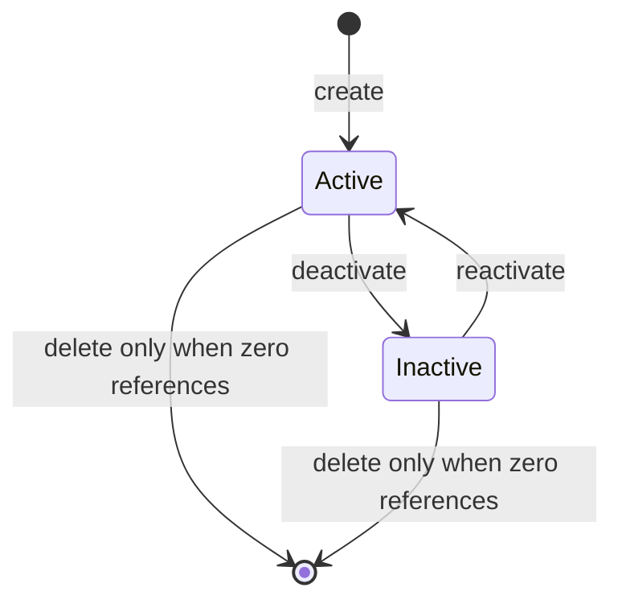

# Process — reference data administration

## As-is


## To-be

```mermaid
flowchart LR
  Admin[Admin user] --> UI[Reference Data admin UI]
  UI --> RefAPI[/api/reference/{type}/]
  RefAPI --> DB[(ReferenceItem + Categories)]
  JobsAPI[Job/Asset APIs] --> RefAPI
```

## Reference item lifecycle



## Decision table — delete request

| In use count | Action | HTTP |
|--------------|--------|------|
| 0 | Remove row or hard delete | 204 |
| ≥ 1 | Soft deactivate only | 409 or DELETE maps to deactivate per FR-1324 |
